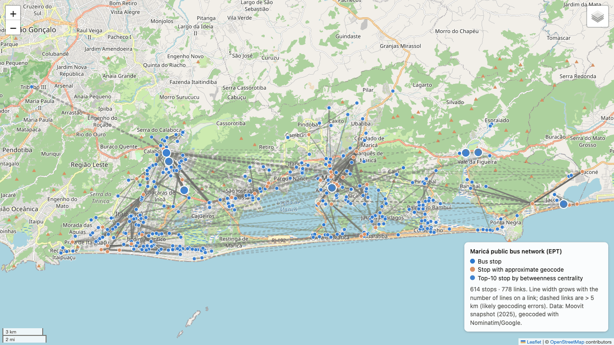
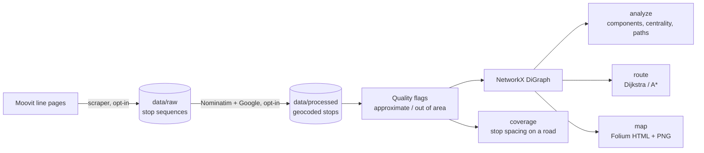
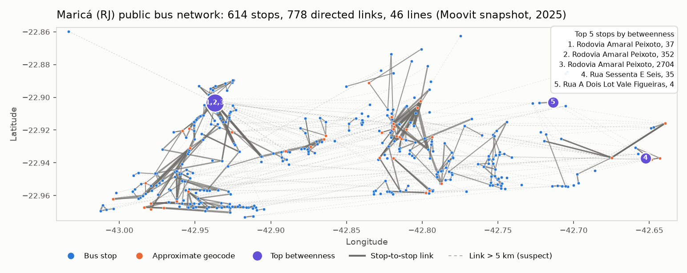

# Maricá Transit Network

A graph model of the public bus network of Maricá (RJ, Brazil). It scrapes stop sequences
from Moovit, geocodes them and analyses the result as a NetworkX directed graph, with
interactive maps.

[](https://github.com/gcfialho/uerj-marica-transit-network/actions/workflows/ci.yml)  [](LICENSE)

[](https://gcfialho.github.io/uerj-marica-transit-network/)

**Live map:** <https://gcfialho.github.io/uerj-marica-transit-network/>. Also available:
[Itaipuaçu](https://gcfialho.github.io/uerj-marica-transit-network/itaipuacu.html),
[shortest route](https://gcfialho.github.io/uerj-marica-transit-network/route-optimization.html) and
[stop spacing on Av. Carlos Marighella](https://gcfialho.github.io/uerj-marica-transit-network/main-road-coverage.html).
The source files are in [`docs/`](docs/).

## Highlights

- **Scraping with an opt-in fetcher:** a Moovit scraper with retries and back-off collects
  46 EPT lines and their ordered stop lists. It runs only with `--force-rescrape`, from the
  optional `fetch` extra.
- **Geocoding with caching:** each unique stop name is geocoded once, with Nominatim first
  and Google as a fallback. Results are saved to CSV, so normal runs need no network or API
  key. Every stop gets a quality flag (precise, approximate or out of area).
- **Graph modelling and centrality:** stops are nodes and consecutive stops of a line are
  weighted directed edges. Metrics include strongly and weakly connected components,
  reciprocity, degree and betweenness centrality, and shortest paths.
- **Spatial analysis and maps:** region subgraphs (Itaipuaçu), Dijkstra routes
  cross-checked with A\*, fewest-transfer ride plans and stop-spacing gaps along a road.
  The results are drawn as Folium maps published to GitHub Pages from `docs/`.
- **Bug audit:** the original course scripts were audited and their errors fixed. Among
  them were fake links in the Itaipuaçu study, lost line attributions and an artificial hub
  created by merging stops (see [Methodology](#methodology)).

## Quickstart

Requires [uv](https://docs.astral.sh/uv/). Runs offline from the committed data snapshot.

```bash
git clone https://github.com/gcfialho/uerj-marica-transit-network.git
cd uerj-marica-transit-network
uv sync
uv run marica-transit analyze      # network statistics (Maricá + Itaipuaçu)
uv run marica-transit route        # shortest route across Jardim Atlântico
uv run marica-transit coverage     # stop spacing along Av. Carlos Marighella
uv run marica-transit all          # regenerate every map, the PNG and docs/network_stats.json
```

To re-scrape or re-geocode, which needs the network, run
`uv sync --extra fetch` and add `--force-rescrape` or `--force-regeocode` to any command.
Google geocoding reads `GOOGLE_MAPS_API_KEY` (see [`.env.example`](.env.example) and use
`uv run --env-file .env ...`).

## How it works



| Module | Responsibility |
|---|---|
| `cli.py` | `marica-transit build-graph \| analyze \| map \| route \| coverage \| all` |
| `pipeline.py` | Loads the committed snapshot; scrapes or geocodes only when forced |
| `data.py` | CSV schema and validation, geocode quality flags |
| `geo.py` | Haversine distance, region bounding boxes |
| `graph.py` | Graph construction, induced region subgraphs, GraphML export |
| `analysis.py` | Network statistics, centrality, Dijkstra / A\*, ride plans |
| `coverage.py` | Ordering stops along a road and detecting gaps |
| `maps.py` | Folium maps and the static Matplotlib preview |
| `scraper.py`, `geocoder.py` | Network access (optional `fetch` extra) |

| Command | What it does |
|---|---|
| `build-graph [--graphml PATH]` | Build the graph and export GraphML (default `output/marica_network.graphml`) |
| `analyze [--region marica itaipuacu] [--top N] [--json PATH]` | Components, density, reciprocity, shortest paths, top stops by betweenness, degree and lines served |
| `map [--out-dir docs] [--png PATH]` | Interactive maps of the full network and Itaipuaçu, plus a static PNG |
| `route [--from STOP --to STOP \| --from-coord=LAT,LON --to-coord=LAT,LON] [--region]` | Shortest route (Dijkstra, cross-checked with A\*) and the fewest-transfer ride plan |
| `coverage [--street NAME ...] [--max-gap-m 450] [--region]` | Stop spacing along a road, with a suggested stop for every gap |
| `all [--out-dir docs]` | Everything above with the case-study defaults |

Every command accepts `--data-dir`, `-v` and the opt-in network flags `--force-rescrape`,
`--force-regeocode`, `--geocoder {both,nominatim,google}` and `--contact EMAIL`.

## Results

Computed by `uv run marica-transit analyze` from the committed snapshot. The full output is
in [`docs/network_stats.json`](docs/network_stats.json).

| | Maricá | Itaipuaçu subgraph |
|---|---:|---:|
| Stops (nodes) | 614 | 289 |
| Directed stop-to-stop links (edges) | 778 | 324 |
| Bus lines | 46 | 35 |
| Density | 0.0021 | 0.0039 |
| Reciprocity (links that also run in reverse) | 5.4% | 5.6% |
| Weakly connected components | 1 | 23 |
| Strongly connected components (largest) | 113 (494 stops) | 145 (120 stops) |
| Mean shortest path in the largest SCC | 31.2 stops | 13.5 stops |
| Diameter of the largest SCC | 109 stops | 36 stops |
| Median link, precisely geocoded stops only | 467 m | 491 m |

- **Rodoviária do Povo de Maricá is the main hub:** 27 of the 46 lines stop there, followed
  by 2ª Entrada de Maricá (13) and Terminal de Itaipuaçu (12).
- **The Rodovia Amaral Peixoto (RJ-106) corridor carries the network.** Its stops hold the
  top 3 betweenness scores (0.30 to 0.32), meaning roughly 30% of all shortest paths pass
  through each of them.
- **In Itaipuaçu,** Terminal de Itaipuaçu ranks first by betweenness (0.158), and two Rua
  Carlos Mariguella stops are in the top 4.
- **The network is weakly but not strongly connected.** The snapshot has one stop sequence
  per line, so only 5.4% of links run both ways, and 120 stops sit outside the largest
  strongly connected component.
- **Shortest route across Jardim Atlântico:** 6.62 km over 6 stops with 1 transfer (E20,
  then E32). Dijkstra and A\* return the same path. See
  [notes](analyses/route-optimization/README.md).
- **Stop spacing on Av. Carlos Marighella:** 23 stop locations over 8.96 km, median spacing
  254 m, and 7 gaps above 450 m (the largest is 1,009 m). See
  [notes](analyses/main-road-coverage/README.md).



## Methodology

- **Graph model.** A node is a unique Moovit stop name, positioned at its geocoded
  coordinate. A directed edge `u → v` exists when some line serves `v` right after `u`.
  Each edge records every line that uses it and its length.
  - Repeated consecutive stops are skipped, so there are no self-loops.
  - Stops geocoded outside Maricá are dropped and their lines bridged over them, so routes
    stay connected.
  - Nodes are keyed by name rather than by coordinate. Otherwise, stops that share a
    street-level geocode would merge into artificial hubs.
- **Distance.** The haversine great-circle distance (mean Earth radius 6,371.0088 km).
  - It differs from ellipsoidal distance by under 0.5%, which is far below the error in the
    geocoded positions.
  - A\* uses the same straight-line distance as its heuristic. Since no edge is shorter than
    the straight line between its stops, the heuristic never overestimates, so A\* finds the
    true shortest path.
- **Geocode quality.** A coordinate shared by 3 or more distinct stop names is flagged
  *approximate*. Coordinates outside the Maricá envelope are flagged *out of area*. Links
  longer than 5 km are flagged *suspect*.
- **Region filtering.** Itaipuaçu is the induced subgraph of the stops inside its bounding
  box: an edge is kept only if both of its stops are inside. Stops are never re-linked
  across the boundary.
- **Analyses.**
  - Betweenness is computed on hop counts, so it depends only on line topology and not on
    geocoding.
  - Average shortest paths and the diameter are measured within the largest strongly
    connected component.
  - When a coordinate matches several stops at the same spot, routing tries all of them
    and keeps the shortest route.
  - The ride plan picks the fewest line changes possible along the chosen path.
  - The coverage study matches stops by street name, ignoring accents and case. It chains
    them along the road starting from one end and flags every gap above the threshold.
- **Fixes to the original course scripts:**
  - A link shared by several lines kept only the first line. A line was added only when
    its distance was strictly shorter, which never happens for the same two stops.
  - The Itaipuaçu study re-linked stops after filtering, so lines leaving and re-entering
    the area were joined across the gap: 37 of its 267 links (14%) were not real.
  - Keying nodes by coordinate merged 33 stops geocoded to one street-level point into an
    artificial hub, which was reported as the most central stop (degree 40).
  - The full-network map was skipped whenever the region filter matched any stop.
  - The filtered CSV lost its stop-name column.
  - 67 repeated consecutive stops became self-loops.
  - The stop-name cleaning step was never called.
  - The pickled graph cache was removed: loading a pickle can execute code, and its
    freshness check relied on file timestamps, which `git clone` does not preserve. The
    graph is rebuilt from CSV instead.

## Project structure

```
├── src/marica_transit/   # package (see "How it works")
├── data/
│   ├── raw/              # scraped stop sequences (Moovit snapshot)
│   └── processed/        # + latitude, longitude, geocoded address
├── analyses/             # case-study notes: route optimisation, main-road coverage
├── docs/                 # GitHub Pages: maps, img/, network_stats.json
├── tests/                # pytest suite + fixture network
└── article/              # course article (Portuguese, PDF)
```

## Testing

```bash
uv run pytest
uv run ruff check . && uv run ruff format --check .
```

The 50 tests run on an eight-stop fixture whose answers can be checked by hand. They cover:

- haversine distances and geocode quality flags;
- graph construction: bridging over dropped stops, no self-loops, lines shared on a link;
- induced subgraphs and component counts;
- Dijkstra and A\* agreement, and ride plans;
- road ordering and gap detection;
- CLI smoke runs.

CI runs lint, the tests and an offline pipeline run on Python 3.12 and 3.13.

## Data sources & limitations

Built for the Discrete Mathematics II course (Computer Engineering, UERJ). Article reviewed
by Pedro Mineiro Cordoeira. The article is in Portuguese, at
[`article/`](article/Artigo_Matematica_Discreta_GCF_Final.pdf), and its figures come from the
original course scripts.

- **Stops and lines:** Moovit public pages for the EPT (Empresa Pública de Transportes de
  Maricá), collected around June 2025 (first committed 2025-06-25). The snapshot has 1,718
  stop visits, 619 distinct stop names and 46 lines. The data is crowd-sourced and has no
  timetables or frequencies.
- **Geocoding accuracy is the main limitation:**
  - 251 of the 619 stop names (41%) share a coordinate with at least two other names,
    which points to a street-level fallback. They are shown in orange.
  - 5 names resolved outside Maricá and are excluded. For example, Maricá's Bambuí
    neighbourhood was placed in Bambuí, Minas Gerais, about 460 km away.
  - 23% of links exceed 5 km in a straight line, usually because a generic name such as
    "Rua Nove, 58" matched a street with the same name elsewhere. These links are dashed
    on the maps.
- **Distances** are straight lines between geocoded stops, not road distances, so treat
  kilometre figures as indicative. For example, the 102 km mean shortest path in the full
  network's largest SCC is inflated by the errors above. Topological results (components,
  hop counts, betweenness) are unaffected.
- Re-scraping may conflict with Moovit's terms of service; check them before using
  `--force-rescrape`.

## Author

Guilherme Fialho · Machine Learning Engineer (GenAI/LLMs) and Data Engineer · [LinkedIn](https://www.linkedin.com/in/guilherme-cagide-fialho/) · [GitHub](https://github.com/gcfialho)

Thanks to Pedro Mineiro Cordoeira for reviewing the article.
