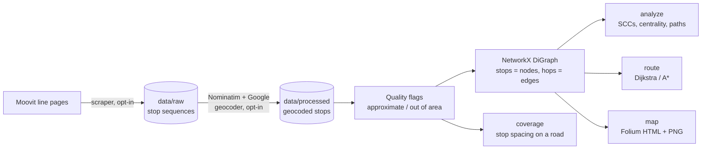

# Maricá Transit Network

Graph model of the public bus network of Maricá (RJ, Brazil): Moovit stop sequences,
geocoded and turned into a NetworkX directed graph for centrality, connectivity and
shortest-route analysis, with interactive Folium maps.

[](https://github.com/gcfialho/uerj-marica-transit-network/actions/workflows/ci.yml)

[](https://docs.astral.sh/uv/)
[](https://docs.astral.sh/ruff/)
[](LICENSE)

[](https://gcfialho.github.io/uerj-marica-transit-network/)

**Interactive maps:** [full network](https://gcfialho.github.io/uerj-marica-transit-network/) ·
[Itaipuaçu](https://gcfialho.github.io/uerj-marica-transit-network/itaipuacu.html) ·
[shortest route](https://gcfialho.github.io/uerj-marica-transit-network/route-optimization.html) ·
[stop spacing on Av. Carlos Marighella](https://gcfialho.github.io/uerj-marica-transit-network/main-road-coverage.html)
(the same files are in [`docs/`](docs/))

Built for the Discrete Mathematics II course (Computer Engineering, UERJ). The accompanying
article is in Portuguese: [`article/`](article/Artigo_Matematica_Discreta_GCF_Final.pdf).

## Pipeline



The committed CSV snapshot is the default input, so everything runs offline. Scraping and
geocoding only happen with `--force-rescrape` / `--force-regeocode`.

## Quickstart

Requires [uv](https://docs.astral.sh/uv/). No API keys or network access needed.

```bash
git clone https://github.com/gcfialho/uerj-marica-transit-network.git
cd uerj-marica-transit-network
uv sync
uv run marica-transit analyze      # network statistics for Maricá and Itaipuaçu
uv run marica-transit all          # regenerate every map, the PNG preview and docs/network_stats.json
```

## CLI

| Command | What it does |
|---|---|
| `build-graph [--graphml PATH]` | Build the graph and export it as GraphML (default `output/marica_network.graphml`) |
| `analyze [--region marica itaipuacu] [--top N] [--json PATH]` | Size, density, reciprocity, weak/strong components, shortest paths, top stops by betweenness, degree and lines served |
| `map [--out-dir docs] [--png PATH]` | Interactive maps of the full network and Itaipuaçu, plus a static PNG |
| `route [--from STOP --to STOP \| --from-coord=LAT,LON --to-coord=LAT,LON] [--region]` | Shortest route (Dijkstra, cross-checked with A\*) and the fewest-transfer ride plan |
| `coverage [--street NAME ...] [--max-gap-m 450] [--region]` | Stop spacing along a road, with a suggested stop for every gap |
| `all [--out-dir docs]` | Run everything above with the case-study defaults |

Every command accepts `--data-dir`, `-v`, and the opt-in network flags `--force-rescrape`,
`--force-regeocode`, `--geocoder {both,nominatim,google}` and `--contact EMAIL`. These need the
`fetch` extra (`uv sync --extra fetch`), and Google needs `GOOGLE_MAPS_API_KEY`
(see [`.env.example`](.env.example); `uv run --env-file .env ...`).

## Key findings

All numbers come from `uv run marica-transit analyze`; the full output is in
[`docs/network_stats.json`](docs/network_stats.json).

| | Maricá | Itaipuaçu subgraph |
|---|---:|---:|
| Stops (nodes) | 614 | 289 |
| Directed stop-to-stop links (edges) | 778 | 324 |
| Bus lines | 46 | 35 |
| Density | 0.0021 | 0.0039 |
| Reciprocity (links that also run in reverse) | 5.4% | 5.6% |
| Weakly connected components | 1 | 23 |
| Strongly connected components (largest) | 113 (494 stops, 80%) | 145 (120 stops) |
| Mean shortest path in the largest SCC | 31.2 stops | 13.5 stops |
| Diameter of the largest SCC | 109 stops | 36 stops |
| Median link, precisely geocoded stops only | 467 m | 491 m |

- **Rodoviária do Povo de Maricá is the main hub by line count:** 27 of the 46 lines stop
  there, followed by 2ª Entrada de Maricá (13) and Terminal de Itaipuaçu (12).
- **The RJ-106 (Rodovia Amaral Peixoto) corridor carries the network.** Its stops hold the
  top 3 betweenness scores (0.30 to 0.32), meaning roughly 30% of all stop-to-stop shortest
  paths pass through each of them. Betweenness is computed on hop counts, so it does not depend on geocoding.
- **In Itaipuaçu,** Terminal de Itaipuaçu ranks first by betweenness (0.158), and two Rua
  Carlos Mariguella stops are in the top 4, which supports treating that road as the
  district's spine.
- **The network is weakly but not strongly connected.** The snapshot has one stop sequence
  per line code, so few links run both ways (reciprocity 5.4%), and 120 stops sit outside
  the largest strongly connected component.
- **Case studies** ([details](analyses/)): the shortest route across Jardim Atlântico is
  6.62 km over 6 stops with 1 transfer (E20, then E32). Along Av. Carlos Marighella, 23 stop
  locations over 8.96 km have a median spacing of 254 m, and 7 gaps exceed 450 m (largest
  1,009 m).


### Corrections to the original course scripts

- Links shared by several lines recorded only the first one, because a line was appended
  only when the new distance was *strictly shorter*.
- The Itaipuaçu case study re-linked stops after filtering, so lines leaving and re-entering
  the area were joined across the gap: 37 of its 267 links (14%) were not real.
- Keying nodes by coordinate merged 33 different stops geocoded to one street-level point
  into an artificial hub, reported as the most central stop (degree 40).
- The full-network map was never regenerated while the Itaipuaçu filter matched any stop,
  the filtered CSV lost its stop-name column, 67 repeated consecutive stops became
  self-loops, and the stop-name cleaning step was defined but never called.
- The pickled graph cache was removed: loading a pickle from a cloned repo can execute
  arbitrary code, and its freshness check relied on file modification times, which `git
  clone` does not preserve. The graph is rebuilt from CSV (under a second) and can be
  exported as GraphML.

Figures in the article come from the original scripts; this README reports what the
current code computes.

## Data sources and limitations

- **Stops and line sequences:** scraped from [Moovit](https://moovitapp.com)'s public pages
  for the EPT (Empresa Pública de Transportes de Maricá) lines around June 2025 (first
  committed on 2025-06-25): 1,718 stop visits, 619 distinct stop names, 46 lines. Moovit is
  crowd-sourced and this is a single snapshot, with no timetables or frequencies.
- **Geocoding:** stop names were geocoded with Nominatim (OpenStreetMap) first and the Google
  Geocoding API as a fallback. Accuracy is the main limitation:
  - 251 of the 619 stop names (41%) share their coordinate with at least two other names,
    which means a street- or neighbourhood-level fallback rather than the real stop
    position. They are kept and shown in orange.
  - 5 names resolved outside Maricá (for example, Maricá's Bambuí neighbourhood was placed in
    Bambuí, Minas Gerais, about 460 km away). They are dropped and their lines bridged over.
  - 23% of links are longer than 5 km in a straight line, usually because a generic name
    such as "Rua Nove, 58" matched a street with the same name elsewhere. Those links are
    dashed on the maps.
- **Distances** are straight lines between geocoded stops, not road distances. Treat
  kilometre figures as indicative (the mean shortest path of 102 km in the full SCC is
  inflated by the errors above). Topological results (components, hops, betweenness) are
  not affected.
- Re-scraping may conflict with Moovit's terms of service; check them before using
  `--force-rescrape`.

## Project structure

```
├── src/marica_transit/
│   ├── cli.py          # argparse entry point: marica-transit <command>
│   ├── pipeline.py     # offline-by-default data loading
│   ├── data.py         # CSV schema, validation, geocode quality flags
│   ├── geo.py          # haversine distance, bounding boxes
│   ├── graph.py        # DiGraph construction, induced subgraphs, GraphML export
│   ├── analysis.py     # network statistics, centrality, Dijkstra / A*, ride plans
│   ├── coverage.py     # stop spacing along a road
│   ├── maps.py         # Folium maps and the Matplotlib preview
│   ├── scraper.py      # Moovit scraper (opt-in, `fetch` extra)
│   └── geocoder.py     # Nominatim / Google geocoder (opt-in, `fetch` extra)
├── data/
│   ├── raw/moovit_stops_raw.csv             # scraped snapshot
│   └── processed/moovit_stops_geocoded.csv  # + latitude, longitude, geocoded address
├── analyses/           # case-study notes: route optimisation, main-road coverage
├── docs/               # GitHub Pages: generated maps, preview images, network_stats.json
├── tests/              # pytest suite with a tiny hand-checked fixture network
└── article/            # course article (Portuguese, PDF)
```

## Testing

```bash
uv run pytest                # 50 tests
uv run ruff check . && uv run ruff format --check .
```

The tests use an eight-stop fixture whose answers can be checked by hand: haversine
distances, quality flags, graph construction (bridging, self-loops, shared links), induced
subgraphs, component counts, Dijkstra and A\* agreement, ride plans, road ordering and gap
detection, and CLI smoke runs. CI runs the same checks on Python 3.12 and 3.13.

## Author

**Guilherme Fialho**, Machine Learning Engineer (GenAI/LLMs) and Data Engineer.
[GitHub](https://github.com/gcfialho) · [LinkedIn](https://www.linkedin.com/in/guilherme-cagide-fialho/)

The article was co-authored with Pedro Mineiro Cordoeira. Code released under the
[MIT License](LICENSE).
